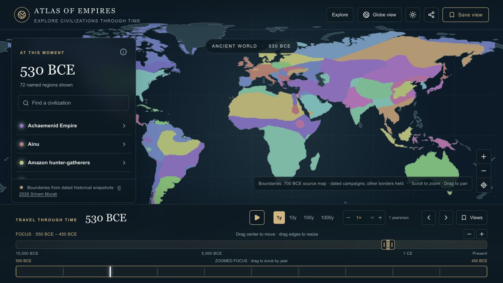
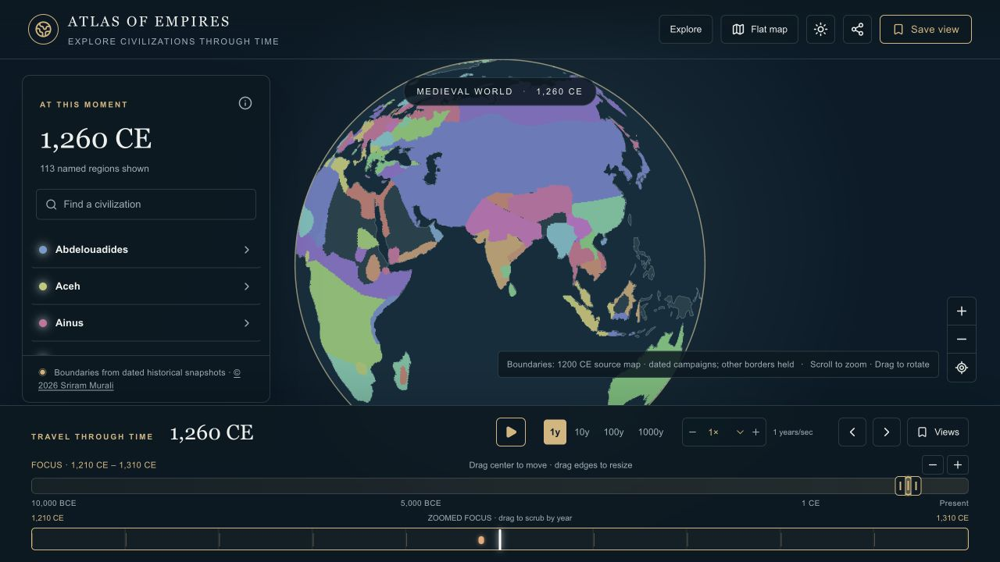
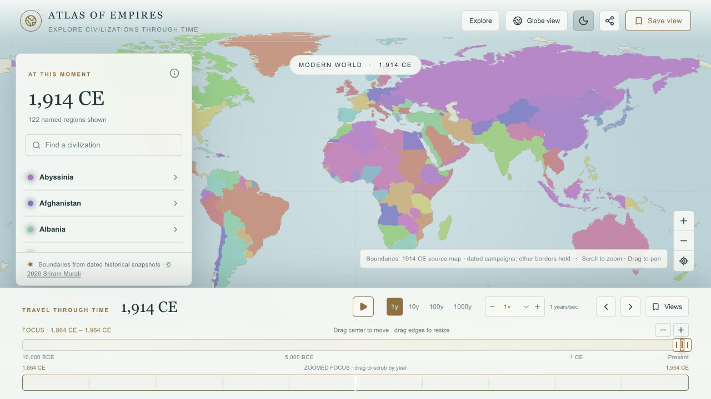

# Atlas of Empires

Explore how civilizations and political boundaries changed from **10,000 BCE to today** on a pannable world map or rotating globe. Scrub to any year, widen or narrow the focus window by dragging its edges, search for a civilization, and play territorial changes at up to 32× speed.

**[Open the live atlas on GitHub Pages →](https://msriram.github.io/atlas-of-empires/)**

> **Historical caution:** Borders between dated source maps are estimates. Ancient and disputed boundaries may be uncertain. This is an educational visualization, not a record of legal sovereignty.

## Screenshots

| Ancient world · 530 BCE | Medieval globe · 1260 CE |
| --- | --- |
|  |  |



## Use the atlas

Visit **[msriram.github.io/atlas-of-empires](https://msriram.github.io/atlas-of-empires/)** in your browser. No installation or account is needed to explore the map.

**Navigation:** drag or scroll the map to pan and zoom; switch to Globe view to rotate it. Drag the **middle** of the small focus bar to move through eras, drag either **edge** to resize it, and drag the enlarged bar below to select a year. The + and − buttons also resize the focus window. Search jumps to a matching civilization's mapped period.

Saved views currently use this browser's local storage. Google account sync is planned and needs OAuth and a persistent backend; it is not part of this repository's current runtime.

## Collaborate

Contributions to geography, citations, history, accessibility, and performance are welcome:

1. Check [open issues](https://github.com/msriram/atlas-of-empires/issues) for an existing report.
2. For a wrong or missing boundary, open a [historical data correction](https://github.com/msriram/atlas-of-empires/issues/new/choose) and include a date, region, source, and the uncertainty.
3. For a bug or an idea, use the matching [issue template](https://github.com/msriram/atlas-of-empires/issues/new/choose). Issues are also the place to give feedback on how to improve the atlas.
4. Read [CONTRIBUTING.md](CONTRIBUTING.md) and the [data contribution guide](docs/DATA_CONTRIBUTIONS.md), then open a [pull request](https://github.com/msriram/atlas-of-empires/pulls). Small, sourced corrections are especially helpful.

See the [project limitations](#historical-boundaries) before interpreting an animated outline as a surveyed annual border.

## Historical boundaries

The basemap is [Natural Earth 1:110m land](https://github.com/nvkelso/natural-earth-vector), public domain. Dated political and cultural polygons in `public/historical/` are simplified derivatives of [André Ourednik's historical-basemaps](https://github.com/aourednik/historical-basemaps), GPL-3.0; see `public/historical/LICENSE`. These maps have uncertain borders, inconsistent coverage, and some historical naming errors. The newest source snapshot is 2010; later years reuse it.

### Continuous geographic ownership

The live map uses a precomputed temporal atlas, replacing the old per-year polygon-clipping worker. Its non-negotiable behavior and regression checks are in [Core requirements](docs/CORE_REQUIREMENTS.md):

1. `scripts/build-atlas.ts` converts dated coordinates into a shared **0.25° longitude/latitude grid**. Smaller source regions take priority where polygons overlap. Holes and longitude wrapping are retained.
2. `app/data/empire-timelines.json` gives each empire its own dated regional campaigns, pauses, gains, and losses. `scripts/lib/campaign-chronology.ts` applies these calendars to the relevant geographic portions of the source outlines. There is no shared world growth schedule. Unchanged geography stays fixed. Where annual evidence is missing, a connected local front estimates movement between dated source outlines; it is not presented as a documented conquest.
3. `scripts/lib/ownership-field.ts` orders a campaign front through connected target geography from retained territory. Each location records previous/next ownership, arrival time, and a narrow sub-year smoothing band. Disconnected components may seed locally when the route is unknown. Polygons are never scaled into growing or shrinking circles. The geographic selectors and resistance are illustrative, not surveyed campaign fronts or measured terrain.
4. `public/atlas/manifest.json` indexes content-addressed, compressed interval files. They encode any annual **or fractional-year** sample without storing thousands of redundant annual polygons.
5. `app/temporal/territory-canvas.tsx` samples the field into bounded vector paths in flat or orthographic globe coordinates. Colored territory is clipped to the same land geometry shown by the base map. Land has one displayed owner. Clicking and rendering use the same geographic ownership field. Shared endpoints are identical across intervals.

Animated intermediate shapes are **estimates, not recovered historical annual coordinates**. The grid also limits very small states and extreme zoom detail. Add dated coordinate keyframes to improve the historical result; interpolation cannot supply missing evidence.

### Playback and performance

Choose a 1, 10, 100, or 1,000-year step and a speed from ¼× to 32× beside Play. Playback advances `step × speed` years per second using a fractional-year animation clock. With **1y and 32×**, that means 32 years per second while rendering intermediate frames. The sidebar updates at most five times per second while the vector map updates at most twelve times per second. Scrubbing or selecting a search result pauses playback; a hidden tab does not catch up in a burst.

The browser runs at most one fetch/decompression worker at a time. Seeking to another interval terminates obsolete work before starting its replacement; decoded buffers transfer to the renderer without copying. It retains the current and previous completed intervals (at most two, about 16 MiB total), and caches at most six compressed files on disk. Forward playback may prefetch its successor; manual scrubbing never triggers speculative loads. The vector layer is bounded in resolution and updates only when the displayed ownership or palette changes. It does not download the full atlas. The clock waits at an uncached interval boundary so the date cannot outrun the map. A new deployment refreshes a stale manifest automatically once. Reloads reuse cached geographic data.

## Add, change, or remove an empire

Edit `app/data/territory-keyframes.json`. Add a track with two or more dated longitude/latitude polygon rings:

```json
{
  "tracks": [
    {
      "name": "Example Kingdom",
      "frames": [
        { "year": -500, "p": 2, "r": [[[10, 40], [12, 40], [12, 42], [10, 42]]] },
        { "year": -450, "p": 2, "r": [[[9, 39], [14, 39], [14, 43], [9, 43]]] }
      ]
    }
  ],
  "hidden": []
}
```

Negative years are BCE. `r` is an array of polygon rings; each point is `[longitude, latitude]` in degrees. A track overrides a source region with the same name for the track's date range; it can also add an entirely new region. To remove a source region, add its exact name to `hidden`. To remove a custom region, delete its track. Authored coordinate tracks explicitly opt into estimated interpolation between their frames. Identical frames remain static. Run `npm run build:atlas` after changing geographic data and include the updated atlas manifest and interval files in the pull request. Merging to `main` triggers the GitHub Pages rebuild and publishes the new data.

### Independent campaign data

`app/data/empire-timelines.json` is the live calendar. Each profile has names, an approximate origin, a fallback policy, sources, and regional stages. For example:

```json
{
  "id": "example",
  "names": ["Example Kingdom"],
  "origin": [12, 41],
  "fallback": "estimated",
  "source": "https://example.org/historical-source",
  "stages": [
    {"id": "northern-campaign", "action": "gain", "start": 120, "end": 125,
     "bounds": [10, 40, 18, 47], "source": "https://example.org/campaign-source"},
    {"id": "western-loss", "action": "loss", "start": 170, "end": 174,
     "region": [[10,40],[12,40],[12,44],[10,44]], "source": "https://example.org/loss-source"}
  ]
}
```

`bounds` means `[west, south, east, north]`; `region` is a geographic selection polygon. Both are clipped to the dated source shapes. They select where a campaign applies, rather than defining a circle around a capital. Later, more specific stages take priority where selectors overlap. A stage whose dates partly overlap a source interval is constrained by that interval's endpoints. The current source geometry cannot reconstruct a conquest and reversal wholly missing from every source map; add coordinate keyframes for that case.

The default fallback is `estimated`. Changed cells move along a geographically ordered front during their source interval; unchanged cells never move. An individual profile can use `hold` only when a sourced one-year transfer at the next map date is justified. There is no random growth or calendar-wide expansion curve. Existing profiles cover Rome's provinces and fragmentation, Achaemenid conquests, Alexander's campaigns/succession, Mongol campaigns/fragmentation, Yuan conquest of Song territory, Ottoman campaigns, and the Umayyad transition. Their source links support chronology; their intermediate outlines remain approximate.

The build derives Mongol anchors at 1206 and 1260 from the 1200 and 1279 source outlines. Later source maps supply successor regions. `app/data/territory-transfers.json` and the old polygon worker are retained as reference for the previous engine; the live chronology takes precedence. Keyframe dates are map evidence, not necessarily founding or ending dates.

## Timeline, events, and journeys

The narrow selection on the full-history bar moves the focus range. The enlarged bar below it scrubs within that same range in one-year steps; its zoom buttons change the range width. Historical events and their source links are in `app/data/events.ts`. Curated journeys in `app/data/journeys.ts` refer to those event IDs. Search looks across all dated snapshots and custom tracks, jumps the timeline to a matching year, and highlights the region. The region detail panel shows years in which its name appears in source maps; those are coverage dates, not founding and ending dates.

## Navigation and saved views

Drag to pan the flat map, which repeats east to west. Drag to rotate the globe. Scroll or use the buttons to zoom either view. Saved views currently use this browser's storage. Google account sync still requires OAuth setup and a persistent backend.

## Analytics and publication

The site is exported as static HTML, CSS, JavaScript, and atlas data and deployed to GitHub Pages from `main` by [the Pages workflow](.github/workflows/pages.yml). The export is configured for the `/atlas-of-empires/` path. Analytics use Umami when `NEXT_PUBLIC_UMAMI_WEBSITE_ID` is set in the Pages build environment. The tracker honors Do Not Track and records pageviews plus save/view-switch counts. Search queries and saved views are not custom event data. Without an ID, the tracker is disabled.

## Related projects

This is a selected list of complementary historical mapping projects, not a claim that every similar project has been catalogued. Their data, licenses, and historical interpretations differ:

| Project | What it offers |
| --- | --- |
| [Running Reality](https://www.runningreality.org/) | A detailed world history model with a map, timeline, and research tools. |
| [Chronas](https://www.chronas.org/) | An interactive historical map with linked context. |
| [GeaCron](https://geacron.com/) | A historical atlas with year-based political maps and timelines. |
| [TimeMap / OldMapsOnline](https://www.oldmapsonline.org/en/history/about-timemap) | Time navigation through historical maps, regions, and events. |
| [OpenHistoricalMap](https://www.openhistoricalmap.org/) | A collaborative, time-aware map of world history. |
| [historical-basemaps](https://github.com/aourednik/historical-basemaps) | Open GeoJSON snapshots used as a source for this project's dated boundary data. |
| [Point in History](https://hanshack.com/point-in-history/) | Shows the dated historical map at a chosen point on Earth. |
| [Ourednik's historical map app](https://ourednik.info/historicalmaps/app.html) | Explores the source boundary dataset in alternative map projections. |
| [AtlasPI](https://atlaspi.it/) | Sourced historical geography data, API, and interactive map. |
| [Strata](https://github.com/dr-nico-f/strata) | An open source world history map with multiple data layers. |
| [Chronoglobe](https://github.com/knalpas/chronoglobe) | An open source historical globe with a timeline. |
| [Atlas with stories](https://github.com/daiyip/atlas) | An open source map with historical stories and dated borders. |
| [World History Web](https://github.com/haakram/WHW) | An open source 3D history globe with events and tours. |

See [COPYRIGHT.md](COPYRIGHT.md), [LICENSE](LICENSE), and [CONTRIBUTING.md](CONTRIBUTING.md). GitHub Actions checks tests, lint, type checking, and build on pull requests.
